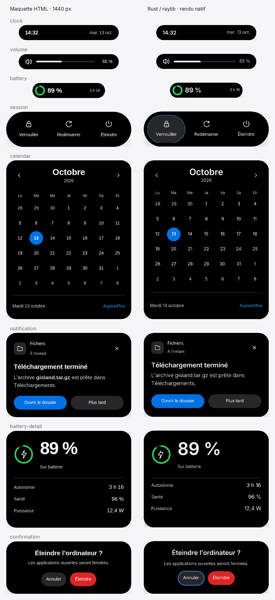

# Native island design parity

Reference: `Refonte-de-Gisland.zip`, supplied on 2026-10-13, SHA-256
`baf9f2cfcae01b4057cec805cd4d100b4e79485ec61dbc5d3e289c4edb2655ae`.
The current `index.html` and its motion note are the visual contract. The white
specimen board and archived `versions/v5` are design tools, not application
screens. This increment targets `rewrite/rust-luajit` and its native X11 overlay.

## Scope and mapping

| Surface | Reference size | Implementation |
| --- | --- | --- |
| Clock / volume | 320 × 48 | Shared compact capsule, 17/14 px labels, 5 px meter, numeric volume |
| Mute | 72 × 56 | Dedicated icon capsule |
| Battery compact | 232 × 48 | 32 px ring with 5 px stroke; green/orange/red thresholds |
| Calendar | 400 × 507 | Month/year, seven equal columns, circular date selection, today footer |
| Notification | 400 × 268 | App header, dismiss, title/body, primary/secondary actions, compact summary |
| History | Content dependent, capped at 520 px | Header, separated records, older-item action, empty state |
| Battery detail | 400 × 309 | 64 px ring, 56 px value, state, separated facts |
| Battery alert | 400 × 91 | Warning, charge level, dismiss |
| Session | 400 × 112 | Lock / restart / power off; 44 px minimum controls |
| Confirmation | 400 × 168 | Cancel by default; guarded destructive action |

`assets/theme.lua` owns colors, typography, controls, geometry and spring presets.
The renderer resolves these tokens before layout; measurement and painting use
the same font metrics. SVG icons are derived from the supplied paths and are
included by the local installer. The launcher keeps its existing 432 × 344
surface; it has no specimen in this archive. The existing `sleep` action remains
available through IPC, while the visible session menu follows the three choices
in the mockup.

The envelope tracks position and velocity for width, height, radius, padding,
opacity and vertical position. Opening/closing/expansion/collapse/module changes
use 380/240/400/260/320 ms spring response presets. Geometry uses the handoff's
bounce and 0.6 period ratio; opacity and vertical movement are critically damped.
Content fades independently without scaling. Reduced motion snaps to targets.
The overlay clamps to the available window width, with narrower calendar cells.
Tab and Shift+Tab cycle actions; Enter activates; Escape collapses without deleting
the default calendar. Clicking a control acquires focus; hovering does not.

## Verification

```sh
cargo build --locked
cargo test --locked
cargo clippy --locked --all-targets -- -D warnings
cargo fmt --check
scripts/check-visual.sh
bash -n scripts/install-local.sh scripts/check-visual.sh
git diff --check
```

The ordinary test suite runs the Lua calendar/audio, session safety and runtime
focus checks, plus theme, geometry, spring and keyboard tests. The separate Xvfb
test renders 17 states at window widths 472 and 360, asserts control bounds,
black surfaces and translucent shadows, and saves 34 PNGs under
`target/design-screenshots`. All visual fixtures mock system actions.

An additional isolated Xvfb / D-Bus session verified app startup, all six enabled
modules running, IPC calendar navigation, Tab/Enter/Escape, session confirmation
and cancellation, launcher typing, and configuration reload. No suspend,
restart, lock or power-off command was executed on the desktop.



The reference uses an SF/Helvetica/Arial font stack. The native application keeps
its bundled, licensed Inter fonts, calibrated to CSS em sizes; glyph shapes,
font weight and antialiasing therefore differ. This is a visual port, not a
pixel-identical browser rendering. Screenshot comparisons are manual, with
geometric assertions in the native test. The web board's mobile/tablet navigation
is not part of this desktop product. No local service installation was performed.
